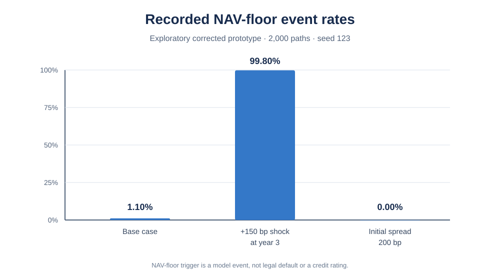
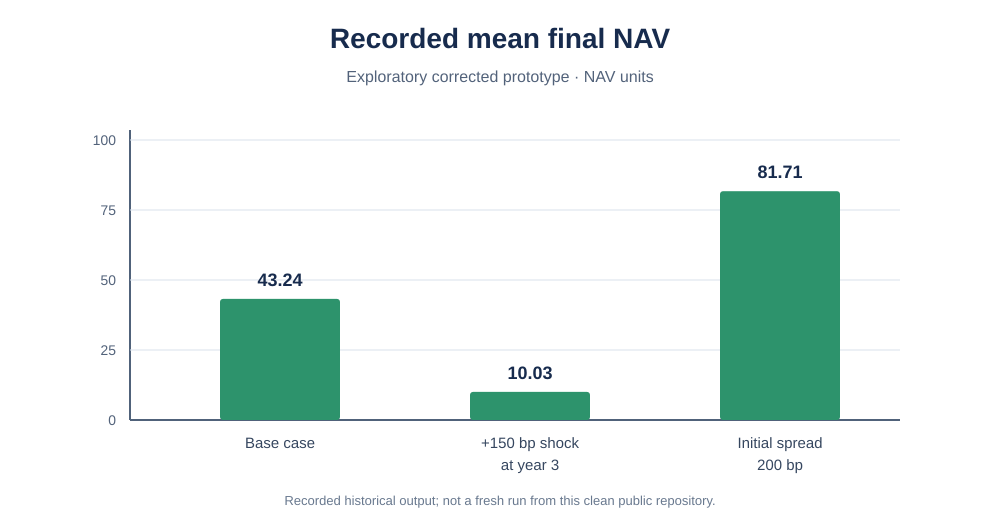

# CPDO Construction & Credit-Risk Modelling

**Collaborative university research · Quantitative finance · Credit spreads · Monte Carlo simulation · Dynamic leverage · Stress testing**

> **Research prototype, not a validated pricing, credit-rating or trading model.** Results depend on simplifying assumptions and have material unresolved limitations.

## Research question

How can a dynamically leveraged structured-credit product appear resilient under ordinary spread conditions while suffering severe losses under a large credit-spread shock?

This project studies **Constant Proportion Debt Obligations (CPDOs)** through stochastic credit-spread modelling, dynamic exposure, cash-flow assumptions and portfolio net-asset-value (NAV) simulations.

## Project contents

| Resource | Description |
|---|---|
| [CIR + empirical-jump notebook](notebooks/01_cir_jump_cpdo.ipynb) | CIR spread dynamics, empirical jumps and NAV simulation, with a revised exploratory default-loss approximation |
| [Regime-switching notebook](notebooks/02_regime_switching_experimental.ipynb) | Alternative log-OU and regime-based approach; experimental |
| [Exploratory model results](docs/CORRECTED_RESULTS.md) | Previously recorded outputs and limitations |
| [Corrections and validation](docs/CORRECTIONS_AND_VALIDATION.md) | Changes made and unresolved model risks |
| [Audit of original report](docs/RESULTS_AUDIT.md) | Inconsistencies and claims requiring verification |
| [Original group report](docs/report_original_submission.md) | Historical submission, preserved with a warning |
| [Contribution context](CONTRIBUTIONS.md) | Collaborative project and authorship note |
| [Data instructions](data/README.md) | Input schemas; raw data are not redistributed |

## Selected exploratory results

The revised CIR/jump prototype was previously run with **2,000 simulated paths per scenario**, using seed **123**. A “default” here means crossing a simulated NAV floor; it is **not** equivalent to legal issuer default or an external rating classification.

| Scenario | NAV-floor event | Cash-out event | Mean final NAV |
|---|---:|---:|---:|
| Base case | 1.10% | 0.00% | 43.24 |
| Permanent +150 bp shock at year 3 | 99.80% | 0.00% | 10.03 |
| Initial spread of 200 bp | 0.00% | 10.45% | 81.71 |

These are recorded exploratory outputs, **not real-world default forecasts**. They are not a fresh run from the clean public repository. See [full interpretation](docs/CORRECTED_RESULTS.md).





## Method overview

1. Inspect historical investment-grade credit-spread and interest-rate observations.
2. Estimate a mean-reverting CIR-style spread process and empirical jump component.
3. Simulate dynamic leverage, carry, coupon obligations, spread mark-to-market and NAV triggers.
4. Explore baseline and hypothetical shock scenarios.
5. Identify model risk, data limitations and inconsistencies between submitted claims and model outputs.

## Repository layout

```text
notebooks/  Two research notebooks
figures/    SVG charts of recorded exploratory outcomes
docs/       Original report, corrected results, audit and validation notes
data/       Input instructions only; no market-data files
tests/      Basic checks on recorded values
```

## Reproduction

1. Install dependencies: `python -m pip install -r requirements.txt`.
2. Obtain source data **from an authorized provider**. Place local files in `data/` as described in [data instructions](data/README.md). No raw CSV or Excel data is included.
3. Run Jupyter from the `notebooks/` directory and execute cells in order.
4. The CIR notebook requires `cdx_spread.csv` and `sofr_daily.csv`. The alternative regime model requires `market_risk.xlsx`.
5. Run the lightweight integrity check with `python -m pytest -q`.

**Reproducibility status:** Notebook source code passed syntax parsing and selected model sections were executed in an earlier local review using files that are not included here. Full end-to-end execution from a fresh environment using independently authorized input data has not been established. The basic pytest check validates the structure of recorded values only; it does not validate financial mathematics.

## Material limitations

- The original CDX calibration sample begins in 2011 and excludes the 2007–2009 global financial crisis.
- The revised simulator may count the same reference-name default more than once; persistent survivor accounting is not implemented.
- Default events are sampled independently; correlated systemic defaults are not modelled.
- Spread mark-to-market and realized credit-default losses may be treated inconsistently or double-counted.
- CIR diffusion and empirical-jump calibration may overlap in tail risk.
- Interest-rate, coupon, settlement and stress-shock mechanics are simplified.
- The alternative regime model is experimental and uses different event definitions; its outputs are not directly comparable.
- No external credit rating, validated probability of default or investment conclusion is established.

See [corrected results](docs/CORRECTED_RESULTS.md), [corrections and validation](docs/CORRECTIONS_AND_VALIDATION.md), and the [audit](docs/RESULTS_AUDIT.md).

## Collaboration and licensing

This was a **university group project**, and the repository presents it as collaborative work. The contributor's described involvement covered a combination of modelling, coding, analysis, simulation and research/documentation tasks; the precise allocation across the group is not itemized.

No raw CSV/XLSX market datasets, presentation binaries or the original private repository's Git history are included. No open-source license is granted; reuse rights should be agreed by the project contributors. See [licensing status](LICENSE_NOT_INCLUDED.md).

**Not investment advice.**
